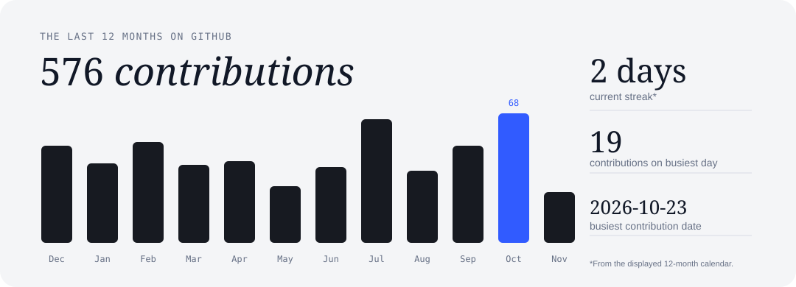
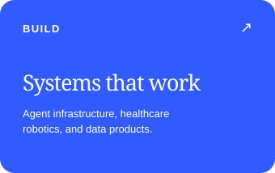
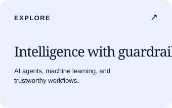
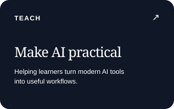
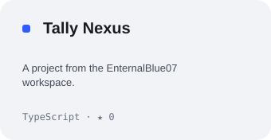
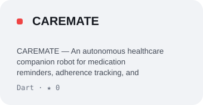
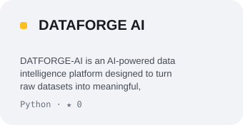

<picture>
  <source media="(prefers-color-scheme: dark)" srcset="https://capsule-render.vercel.app/api?type=rect&height=170&text=ZUMAAN%20SAYYED&fontSize=54&fontColor=F8FAFC&fontAlignY=42&desc=AI%20SYSTEMS%20%E2%80%A2%20SOFTWARE%20ENGINEERING%20%E2%80%A2%20PRODUCT%20BUILDING&descSize=14&descAlignY=68&color=0:020617,48:0B1630,100:123C68" />
  <source media="(prefers-color-scheme: light)" srcset="https://capsule-render.vercel.app/api?type=rect&height=170&text=ZUMAAN%20SAYYED&fontSize=54&fontColor=0B1220&fontAlignY=42&desc=AI%20SYSTEMS%20%E2%80%A2%20SOFTWARE%20ENGINEERING%20%E2%80%A2%20PRODUCT%20BUILDING&descSize=14&descAlignY=68&color=0:F8FAFC,50:EAF2FF,100:D7E9FF" />
  
</picture>

 

&nbsp;

&nbsp;

  

<em>I turn ambitious ideas into useful software — combining AI, data, automation, and thoughtful product engineering.</em>

---

## / THE BUILDER

<table width="100%">
<tr>
<td width="58%" valign="top">

### Engineer by mindset. Builder by practice.

I’m a software and AI builder interested in the systems behind intelligent products: agent orchestration, data intelligence, automation, trustworthy workflows, and human-centred interfaces.

I enjoy taking a problem from first principles, mapping its architecture, building the core mechanics, and stress-testing the details that make a prototype dependable.

**Currently exploring:** multi-agent systems, applied machine learning, AI evaluation, backend architecture, and developer tooling.

</td>
<td width="42%" valign="top">

### BUILD PRINCIPLES

| | |
|:--|:--|
| `01` | **Understand** the actual problem |
| `02` | **Architect** before adding complexity |
| `03` | **Automate** repetitive work |
| `04` | **Verify** critical behaviour |
| `05` | **Ship** something people can use |

</td>
</tr>
</table>

---

## / WHAT I'M BUILDING

<table width="100%">
<tr>
<td width="50%" valign="top">

### <a href="https://github.com/EnternalBlue07/Tally-Nexus">TALLY NEXUS</a>
**Autonomous Agent Clearinghouse**

An agent-economy settlement engine that turns many small inter-agent obligations into minimal net settlements. AI evaluates task evidence; cryptography verifies signed obligations; deterministic mathematics performs clearing; payment rails execute settlement.

- Multi-agent task exchange and SLA adjudication
- Ed25519-signed micro-IOUs and immutable ledger
- Multilateral netting, financial firewall, PayPal settlement

TypeScript · Node.js · SQLite · PayPal APIs · Ed25519 · SSE · AG Grid

</td>
<td width="50%" valign="top">

### <a href="https://github.com/EnternalBlue07/CAREMATE">CAREMATE</a>
**Autonomous Healthcare Companion**

A connected home-care companion combining a Flutter application with an ESP32-powered medication dispensing robot. The system distinguishes a dispense command from a sensor-confirmed tablet drop and patient acknowledgement.

- BLE GATT communication and hardware state machine
- Medication reminders, stock tracking, caregiver awareness
- Sensor-confirmed dispensing and duplicate-command safeguards

Flutter · Dart · ESP32 · BLE · Embedded C++ · Sensors · Servo Control

</td>
</tr>
<tr>
<td width="50%" valign="top">

### <a href="https://github.com/EnternalBlue07/DATAFORGE-AI">DATAFORGE AI</a>
**Career-Readiness & Technical Evaluation**

A technical assessment workstation built around realistic business investigations: query datasets, diagnose metric anomalies, identify root causes, and communicate decisions through an AI-evaluated briefing.

- Sandboxed SQL investigation with DuckDB / SQLite
- Six-dimension AI reasoning evaluation
- Adaptive skill graph and interview simulation

Python · FastAPI · Next.js · DuckDB · PostgreSQL · Redis · pgvector

</td>
<td width="50%" valign="top">

### <a href="https://github.com/EnternalBlue07/SentinelAI">SENTINEL AI</a>
**Fraud & Anomaly Intelligence**

A risk-intelligence platform that keeps supervised fraud probability separate from unsupervised anomaly signals, with explainability and human review built into the workflow.

- XGBoost fraud modelling + Isolation Forest anomaly detection
- TreeSHAP feature attribution and forensic case dossiers
- PII redaction and traceable event records

Python · FastAPI · Next.js · TypeScript · XGBoost · Isolation Forest · TreeSHAP · PostgreSQL

</td>
</tr>
<tr>
<td width="50%" valign="top">

### <a href="https://github.com/EnternalBlue07/Pact_Resources">PACT</a>
**Proof, Authorization, Custody & Trust**

A resource-custody platform concept for shared campus equipment and spaces. It focuses on eligibility, accountable handovers, fair allocation, and tamper-evident history.

- Eligibility gates and booking lifecycle
- Dual-acknowledgement handover design
- SHA-256 trust ledger and security test scenarios

React · TypeScript · FastAPI · Python · PostgreSQL · SQLAlchemy · Pytest

</td>
<td width="50%" valign="top">

### <a href="https://github.com/EnternalBlue07/CORTEX-OS">CORTEX OS</a>
**Enterprise Intelligence OS**

An exploration of an intelligent workspace that brings operational context, AI-assisted workflows, and structured decision-making into one coherent product experience.

Product Architecture · AI Workflows · Software Design

</td>
</tr>
</table>

More experiments and builds → <a href="https://github.com/EnternalBlue07?tab=repositories">all repositories</a>

---

## / EVERY DAY, IN BLUE

 

 

## / WHAT I'M CODING

Cards are generated from GitHub's contribution calendar and public repository metadata by GitHub Actions, once a day.

---

## / TECHNOLOGY TOOLKIT

**LANGUAGES & DATA**

  

**APPLICATION & BACKEND ENGINEERING**

  

**DATA, INFRASTRUCTURE & CREATIVE TOOLS**

  

**AI ENGINEERING WORKFLOW**

<code>OpenAI API</code> &nbsp; <code>Codex</code> &nbsp; <code>OpenRouter</code> &nbsp; <code>LiteLLM</code> &nbsp; <code>Langflow</code> &nbsp; <code>Agent Workflows</code> &nbsp; <code>Prompt Evaluation</code>

---

## / HOW I WORK

<table width="100%">
<tr>
<td width="33%" valign="top">

### THINK

Problem framing, requirements, research, architecture, and trade-off analysis.

</td>
<td width="33%" valign="top">

### BUILD

Full-stack implementation, AI-assisted development, integration, and interface design.

</td>
<td width="33%" valign="top">

### VERIFY

Automated tests, static analysis, security checks, deterministic behaviour, and iteration.

</td>
</tr>
</table>

---

### LET'S BUILD SOMETHING THAT MATTERS.

Open to thoughtful conversations, engineering collaborations, and ambitious ideas.

&nbsp;

  

Designed with intent · Built with curiosity · Improved with every commit

