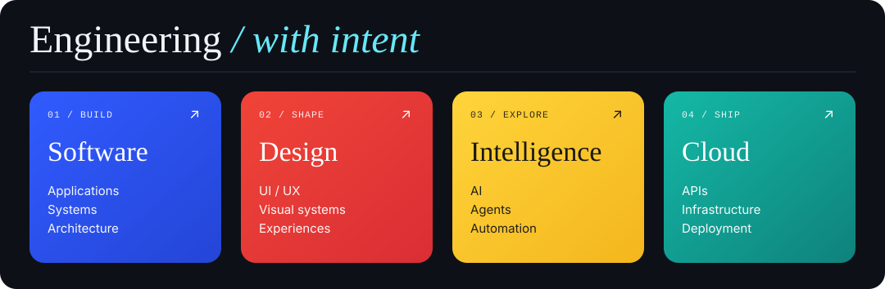
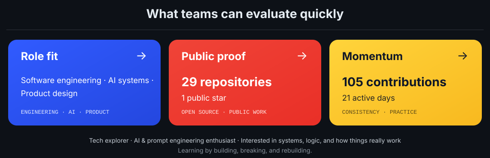
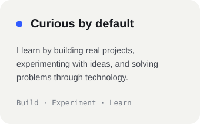
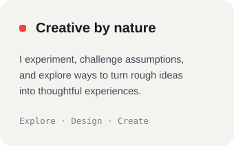
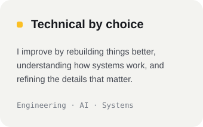

<picture>
  <source media="(prefers-color-scheme: light)" srcset="https://www.gitskins.com/api/section/wordmark?username=enternalblue07&theme=aurora&avatar=https%3A%2F%2Favatars.githubusercontent.com%2Fu%2F171252920%3Fu%3Dcc1412495d9e76ba703f777c54ac32b74274d384%26v%3D4&label=Zumaan%20Sayyed&v=cinematic-hero-wordmark-1&mode=light" />
  
</picture>

<strong>SOFTWARE ENGINEER IN THE MAKING · AI BUILDER · SYSTEMS THINKER</strong>

 

 

&nbsp;&nbsp;&nbsp;

&nbsp;&nbsp;&nbsp;

&nbsp;&nbsp;&nbsp;

&nbsp;&nbsp;&nbsp;

&nbsp;&nbsp;&nbsp;

 

✦ &nbsp; SOFTWARE ENGINEERING &nbsp; ◆ &nbsp; AI SYSTEMS &nbsp; ◆ &nbsp; CLOUD &amp; INFRASTRUCTURE &nbsp; ◆ &nbsp; PRODUCT DESIGN &nbsp; ✦

---

## `00 / ENGINEERING`

  

## `01 / TECHNOLOGY`

### LANGUAGES

 

 

### DEVELOPMENT

 

 

### CLOUD • DATABASE • SYSTEMS

 

 

### DESIGN • CREATIVE

 

---

## `02 / A FEW WORDS`

 

&nbsp;&nbsp;

---

## Contribution trail

✦ THANKS FOR VISITING ✦

